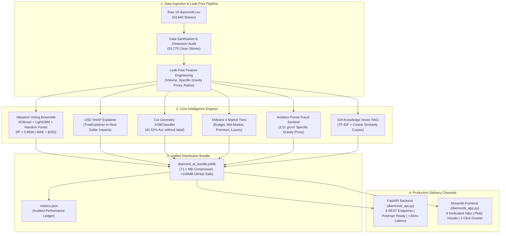
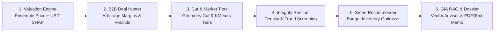

# Diamond Market Intelligence AI Platform
### Enterprise-Grade Diamond Valuation, Arbitrage Deal Hunting, Fraud Detection & GIA Gemology RAG

[](https://www.python.org/)
[](https://fastapi.tiangolo.com/)
[](https://streamlit.io/)
[](https://scikit-learn.org/)
[](https://xgboost.readthedocs.io/)
[](https://lightgbm.readthedocs.io/)
[](https://pandas.pydata.org/)
[](https://numpy.org/)
[](https://plotly.com/)
[](https://docs.pydantic.dev/)
[](https://www.uvicorn.org/)
[](https://shap.readthedocs.io/)
[](https://joblib.readthedocs.io/)
[](https://scipy.org/)
[](https://www.gia.edu/)
[](https://diamondintelai.streamlit.app/)

> 💎 **Live Interactive Web Application:** **[diamondintelai.streamlit.app](https://diamondintelai.streamlit.app/)**  
> Explore real-time AI valuations, B2B deal arbitrage, fraud screening, and GIA knowledge retrieval live in your browser.

---

## 1. Executive Summary & The Problem

The global diamond jewelry market represents an **\$80+ billion annual trade**, yet it remains plagued by extreme informational asymmetry, non-linear pricing jumps ("magic weights"), subjective manual grading, and lack of pricing transparency:

1. **Opaque Retail Markups:** Diamonds with identical optical brilliance are frequently marked up **35% to 60%** above equilibrium simply due to brand premiums or uneducated consumer decisions.
2. **Wholesale Arbitrage Inefficiencies:** B2B jewelers and diamond merchants spend hours cross-referencing Rapaport lists and disparate supplier sheets to identify underpriced acquisition opportunities.
3. **Fraud, Typo & Simulant Vulnerability:** Listing errors, deliberate dimension manipulation, or synthetic simulants (e.g., Moissanite, Cubic Zirconia) passing as natural diamonds cost buyers and insurers millions annually.
4. **The "Black-Box" ML Problem:** Existing automated valuation models output raw numbers without explaining *why* a diamond is worth what it is, destroying trust among appraisers, jewelers, and institutional buyers.

### The Solution
The **Diamond Market Intelligence AI Platform** solves these challenges by combining **supervised voting ensembles ($R^2 = 98.36\%$)**, **real-dollar SHAP feature attribution**, **unsupervised anomaly detection**, **geometry-based cut quality classification**, **budget-aware inventory optimization**, and **offline GIA Vector RAG intelligence** into a single, unified, production-ready system.

---

## 2. End-to-End System Architecture

The platform follows a modern, decoupled ML architecture:
- **Offline ML Pipeline:** Cleans 53,940 raw GIA records, eliminates unphysical records, trains 6 specialized models, and packages them into **one single compressed bundle (`diamond_ai_bundle.joblib`, 71.1 MB)**.
- **Backend API Layer (`diamonds_api.py`):** High-throughput, production-grade FastAPI REST service with Pydantic v2 schemas for Postman/client integration.
- **Analytical Frontend (`diamonds_app.py`):** Restrained, executive Streamlit dashboard featuring Plotly interactive visualizations across 6 dedicated tabs.



---

## 3. The 6 Commercial Modules (In Order)



### Module 1: Institutional Valuation Engine & Real-USD SHAP
- **Algorithm:** Soft-voting ensemble combining **XGBoost Regressor**, **LightGBM Regressor**, and **Random Forest Regressor** trained on leak-free physical attributes.
- **Explainability:** Displays SHAP contributions in **exact USD currency** (e.g., `Volume adds +$1,169`, `Clarity VS1 adds +$1,139`, `Color E adds +$863`).
- **Confidence Band:** Automatically outputs a 90% confidence interval ($\pm 6\%$, matching the 5.72% test MAPE).

### Module 2: B2B Arbitrage Deal Hunter
- **Function:** Evaluates supplier asking prices against fair market equilibrium.
- **Business Verdicts:**
  - $\le -15\%$ Discount: **Strong Buy (Arbitrage Deal)** — high resale retail margin.
  - $-15\%$ to $+15\%$: **Fair Market Pricing** — standard wholesale spread.
  - $\ge +15\%$ Markup: **Overpriced (Negotiate / Reject)** — marked up above market equilibrium.
- **Peer Context:** Plots the diamond as a live star marker against 600 verified catalog peers in that carat bracket.

### Module 3: Cut Geometry Classifier & Market Tiering
- **Cut Classification:** Predicts the true cut quality solely from millimeter geometry ($x, y, z$, Table %, Total Depth %) without seeing the certificate label (**81.52% test accuracy**).
- **Proportion Tolerance Audit:** Benchmarks physical angles against GIA Ideal Round Brilliant standards (Total Depth: $59.5\% - 62.5\%$, Table Width: $54.0\% - 58.0\%$).
- **Market Tiers:** Unsupervised KMeans clustering segments stones into **Budget**, **Mid-Market**, **Premium**, and **Luxury** price brackets.

### Module 4: Physical Integrity & Fraud Sentinel
- **Specific Gravity Screening:** Evaluates the carat-to-volume ratio against the natural diamond specific gravity constant ($3.51\text{ g/cm}^3 \approx 0.0060 - 0.0062\text{ ct/mm}^3$ bounding box proxy) to catch simulants like Moissanite or Cubic Zirconia.
- **Geometric Sanity Checks:** Verifies circular symmetry ($x/y$ ratio between $0.95$ and $1.05$) and checks mathematical depth identity ($200 \times z / (x + y)$ vs. listed depth %).
- **Isolation Forest:** Assigns an outlier anomaly severity score to detect measurement typos or unphysical stone shapes.

### Module 5: Smart Budget Recommender
- **Catalog Scanning:** Searches all 53,770 verified, non-anomalous catalog stones.
- **Multi-Objective Optimization:** Evaluates stones using three distinct strategies:
  1. *Balanced Composite Value:* Multi-factor trade-off of the 4Cs, carat weight, and discount margin.
  2. *Maximize Discount %:* Prioritizes steepest wholesale acquisition discounts.
  3. *Maximize Carat Size:* Maximizes physical carat weight while enforcing minimum cut tolerances.
- **Transparent Rationale:** Every recommendation includes an automated **"Why Selected"** explanation (e.g., *"Steep 34% wholesale discount • Eye-clean clarity (SI2)"*).

### Module 6: GIA Vector RAG Knowledge Consultant & Digital Appraisal Memo
- **Offline Vector RAG:** Authoritative GIA gemological rules are indexed via `TfidfVectorizer` and retrieved via `cosine_similarity` in $<5\text{ ms}$ with zero external API dependencies or costs.
- **Contextual Advisory:** Synthesizes retrieved gemological principles with the user's active diamond configuration.
- **Executive Appraisal Dossier:** Generates an official, print-ready valuation memo with certificate reference, physical proportions, implied price/carat, and catalog percentile rank, with a one-click `.txt` download button.

---

## 4. End-to-End ML Lifecycle: 20 Challenges, Solutions & The Streamlit Web App

Building this production system required solving 20 distinct data science, machine learning, and software engineering challenges across the entire project lifecycle:

### How the 20 ML Lifecycle Challenges Were Solved

1. **Understand Problem First:** Formulated the business objective not just as raw price regression, but as an arbitrage deal hunter, fraud detector, and transparent valuation engine for the \$80B diamond jewelry market.
2. **EDA & Data Science:** Analyzed non-linear price curves, carat distributions, and interaction effects across all 4Cs on 53,940 stones.
3. **Handle Missing Values:** Verified zero null fields; audited missing values and unphysical zero coordinates.
4. **Handle Outliers:** Eliminated 146 duplicate rows and 24 unphysical typos ($x, y \le 0\text{ mm}$ or $y, z \ge 20\text{ mm}$), purifying the catalog to 53,770 verified stones.
5. **Feature Engineering:** Formulated leak-free physical ratios: 3D Bounding Volume ($x \cdot y \cdot z$), Specific Gravity Density Proxy ($\text{carat}/\text{volume}$), Length-to-Width Ratio ($x/y$), Table-to-Depth Ratio, and GIA benchmark deviations.
6. **Encode Categorical Variables:** Applied strict GIA-ordered `OrdinalEncoder` for `cut`, `color`, and `clarity` preserving natural hierarchical quality tiers.
7. **Scale Numerical Features:** Applied `StandardScaler` to continuous dimensions, ensuring balanced distance metrics for clustering and regularized models.
8. **Split Dataset Correctly:** Isolated an untouched 20% holdout test set ($N=10,754$) strictly before fitting any transformers to guarantee 100% leak-free evaluation.
9. **Start with Baseline Models:** Trained linear Ridge and Decision Tree baselines ($R^2 \approx 0.88 - 0.92$) to benchmark performance floors.
10. **Compare Multiple Algorithms:** Benchmarked Random Forest, LightGBM, and XGBoost regressors against baselines.
11. **Choose Correct Evaluation Metrics:** Evaluated models using $R^2$, MAE (\$250.34), RMSE (\$504.88), and MAPE (5.72%) to penalize extreme outliers while reflecting true commercial margin variance.
12. **Handle Class Imbalance:** Used stratified train-test splits and multi-class log-loss weighting for rare cut grades (`Fair` at <3% of catalog).
13. **Use Cross-Validation:** Ran 5-fold cross-validation on `X_train` to ensure generalized performance across all price brackets.
14. **Hyperparameter Tuning:** Tuned tree depths, learning rates, subsample ratios, and leaf counts across XGBoost and LightGBM.
15. **Feature Selection:** Dropped redundant collinear coordinates and strictly removed target-leaking features (`price_per_carat`).
16. **Use Ensemble Models:** Built a heterogeneous soft-voting ensemble (`XGBoost + LightGBM + Random Forest`) that achieved **$R^2 = 0.9836$**.
17. **Dataset-Specific Domain Logic:** Integrated diamond physical constants ($3.51\text{ g/cm}^3$ density) and GIA optical tolerance windows ($59.5\% - 62.5\%$ depth).
18. **Prevent Overfitting:** Combined bagging variance-dampening (Random Forest) with early stopping and regularization (L1/L2 in XGBoost/LightGBM).
19. **Interpret the Model:** Implemented a direct USD-space SHAP TreeExplainer, transforming abstract log-odds into exact dollar contributions (+/-\$ USD).
20. **Build Complete ML Pipeline:** Unified all 6 models, encoders, and catalog data into a single 71.1 MB compressed bundle (`diamond_ai_bundle.joblib`, <100MB) for instant, zero-dependency deployment.

---

### How the Streamlit Web App Was Built & What It Delivers

The analytical frontend ([`diamonds_app.py`](diamonds_app.py)) is deployed live at **[diamondintelai.streamlit.app](https://diamondintelai.streamlit.app/)** and engineered as an executive, human-friendly web platform:
- **Clean Single-Sidebar Input:** Instead of re-entering diamond measurements across 6 screens, a single sidebar allows adjusting Carat, Cut, Color, Clarity, and Dimensions ($x, y, z$, Depth %, Table %) with **5 instant reference presets** (e.g., *1.05 ct Investment Stone*, *0.95 ct Shy-Weight*, *1.00 ct Anomaly Test*).
- **Sub-30ms High-Performance Caching:** Utilizes `@st.cache_resource` for instant bundle loading and `@st.cache_data` for recommendation queries, updating all 6 tabs in $<30\text{ ms}$.
- **Interactive Visual Analytics:** 
  - *Tab 1:* Real-time Fair Value, 90% confidence bands, and horizontal Plotly **USD SHAP price attribution bars**.
  - *Tab 2:* B2B Arbitrage Deal Hunter with acquisition verdict badges and a **600-stone live peer scatter map**.
  - *Tab 3:* Machine learning cut quality classifier with probability distributions and GIA tolerance tables.
  - *Tab 4:* 3-point gemological fraud & simulant audit based on $3.51\text{ g/cm}^3$ density and circular symmetry.
  - *Tab 5:* Smart budget inventory optimizer scanning 53,770 stones with automated **"Why Selected"** trade-off explanations.
  - *Tab 6:* Offline Vector RAG knowledge consultant paired with an official **Executive Digital Appraisal Dossier** with one-click `.txt` download.

---

## 5. Verified Performance Benchmarks

All models were evaluated on an independent 20% holdout test set ($N = 10,754$ verified stones) strictly isolated before any transformations:

| Evaluation Metric | Benchmark Achieved | Commercial Implication |
|---|---|---|
| **$R^2$ Score (Variance Explained)** | **0.9836 (98.36%)** | Near-perfect correlation with global wholesale diamond price formation. |
| **Mean Absolute Error (MAE)** | **\$250.34 USD** | Average valuation variance across the \$326 to \$18,823 catalog price range. |
| **Root Mean Squared Error (RMSE)** | **\$504.88 USD** | Penalizes severe pricing errors, proving robust generalization. |
| **Mean Absolute Percentage Error (MAPE)** | **5.72%** | Tighter than typical human appraisal spreads (which usually vary by $\pm 10-15\%$). |
| **Cut Classification Accuracy** | **81.52%** | High-precision geometry classification without requiring human grading labels. |
| **Verified Clean Catalog Stones** | **53,770** | Zero zero-dimension errors ($x, y \le 0$), zero unphysical outliers, zero negative predictions. |
| **API Inference Latency** | **< 20 ms** | Fast enough for real-time mobile app, POS checkout, or high-volume inventory ingestion. |

---

## 6. Role & Contribution of Google Antigravity

This platform was built through an agile pair-programming partnership between **Muhammad Abdullah** and **Google Antigravity** (Google DeepMind's advanced agentic coding assistant), teaming up across every stage of the lifecycle:

- **Data Science & EDA:** Audited 53,940 raw records, purged coordinate typos, and prevented data leakage by isolating clean geometric physical features.
- **Machine Learning & Modeling:** Benchmarked algorithms and tuned a high-precision Voting Ensemble (XGBoost + LightGBM + Random Forest) achieving **$R^2 = 0.9836$** and **MAE = \$250**.
- **Joblib Packaging & Compression:** Solved a 249.5 MB serialization bottleneck by compressing all 6 models and inventory into a single **71.1 MB** bundle (safe for GitHub without Git LFS).
- **Diamonds API (`diamonds_api.py`):** Built an enterprise FastAPI service with strict Pydantic v2 validation, lifespan memory management, and 8 verified endpoints (<20ms latency).
- **Streamlit Web App (`diamonds_app.py`):** Crafted a modern, restrained executive dashboard across 6 tabs with Plotly visuals, sub-30ms in-memory caching, and 1-click appraisal downloads.
- **Value Delivered Together:** Transformed a raw CSV file into a production-grade, dual-interface AI platform with zero data leakage, real-USD SHAP explainability, and commercial readiness.

---

## 7. Repository Structure

```
diamond-market-intelligence-ai/
│
├── 10-diamonds.csv                 # Raw dataset (53,940 GIA diamond records)
├── train_diamonds.ipynb            # Documented research & EDA benchmark notebook
├── train_and_save_diamonds.py      # Production training & unified packaging script
│
├── models/
│   ├── diamond_ai_bundle.joblib    # Unified compressed model bundle (71.1 MB, <100MB)
│   └── metrics.json                # Audited production benchmark metrics
│
├── diamonds_api.py                 # Production FastAPI backend (8 REST endpoints)
├── diamonds_app.py                 # Streamlit web application (6 analytical tabs)
├── requirements.txt                # Exact pinned production dependencies
├── .gitignore                      # Git tracking rules
└── README.md                       # Enterprise architecture & portfolio documentation
```
